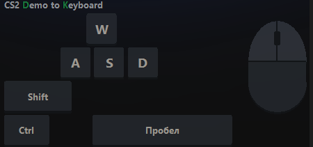

# CS2 Demo to Keyboard

**Клавиатура и мышь игрока из демо CS2 — поверх игры и синхронно с ней.**
Открываете демо, выбираете игрока, и видите каждое нажатие: WASD, прыжки, присед, Shift, выстрелы,
контр-стрейфы — точно по тикам, вместе с картинкой в игре.

Бесплатно и с открытым кодом.



[⬇️ Скачать последнюю версию](../../releases/latest) · [Telegram-канал](https://t.me/cs2demotokeyboard) · [English](#english)

---

## Возможности

- **Клавиатура и мышь поверх CS2**: W, A, S, D, пробел, Ctrl, Shift, ЛКМ, ПКМ, R, E, F, Tab, оружие в руках, выстрелы и броски гранат.
- **Синхронно по тикам** (64 в секунду): клавиатура и демо идут вместе.
- **Управление** кнопками, горячими клавишами **F5–F11** или прямо в CS2: пауза, перемотка, раунды, ×0.5 и ×4.
- **Демо FACEIT и матчмейкинга** (`.dem`).
- **Голос команды** в демо FACEIT: все / Т / КТ / команда игрока / соперники, панель «Кто говорит».
- **Файл клавиатуры `.cs2keys`**: сохранить нажатия игрока (~200 КБ) и передать другому без демо.
- **Интерфейс на русском и английском.**

## Установка

1. Скачайте `CS2_Demo_to_Keyboard_<версия>.exe` со страницы [релизов](../../releases/latest).
2. Один раз в Steam: **CS2 → Свойства → Дополнительный контент → Counter-Strike 2 Workshop Tools** (бесплатно).
3. Запустите `.exe`. Устанавливать ничего не нужно.

Если Windows покажет «Windows защитила ваш компьютер», нажмите **«Подробнее» → «Выполнить в любом случае»**.
Так бывает с программами без платного сертификата разработчика. Код открыт, а `.exe` собирается из него
автоматически на GitHub (вкладка Actions), и у каждого релиза указан SHA-256 файла.

**Новые версии** появляются на странице [релизов](../../releases). Программа сама не обновляется:
скачайте новый `.exe` и замените старый. Настройки и кэш демо сохранятся. Номер вашей версии написан
под названием программы, а по клику на него открывается страница релизов.

## Как пользоваться

1. **«Открыть демо»** или перетащите `.dem` в окно. Демо FACEIT (`.dem.zst`) сначала распакуйте 7-Zip.
2. Нажмите на игрока: нажатия извлекутся за несколько секунд (потом — мгновенно из кэша).
3. **«Запустить CS2 и демо»**: программа сама запустит CS2 в режиме для демо и загрузит запись.
4. Выберите раунд и нажмите **▶**. Клавиатура и игра стартуют вместе.

CS2 должна быть в режиме «Полноэкранный в окне» или «В окне», чтобы клавиатуру было видно поверх игры.

### Горячие клавиши

| Клавиша | Действие |
|---|---|
| F6 | Камера на игрока |
| F7 | Пауза / продолжить |
| F8 | Пересинхронизировать |
| F5 / F9 | Раунд назад / вперёд |
| F10 | Замедление ×0.5 (ещё раз — ×1) |
| F11 | Ускорение ×4 (ещё раз — ×1) |

В самой CS2 на цифровом блоке: 5 — пауза, + / − — скорость, Enter — ×1, 4 / 6 — раунды, 0 — камера.
Ваши прежние бинды программа запоминает и возвращает при выходе. Все клавиши можно переназначить (⚙).

## Как это работает

- **Чтение демо.** CS2 записывает в демо команды, которые клиент игрока отправлял серверу, включая битовую
  маску зажатых кнопок. Программа читает её по каждому тику библиотекой
  [demoparser2](https://github.com/LaihoE/demoparser). Если сырых команд в демо нет, нажатия восстанавливаются
  по движению персонажа и помечаются как приблизительные.
- **Синхронизация.** CS2 запускается с параметром `-netconport`: консоль игры доступна только с этого
  компьютера (127.0.0.1). Программа отправляет `demo_gototick`, `demo_pause`, `demo_resume`, `spec_player`
  и раз в 1,5 секунды сверяет время по ответу «paused on tick N».
- **Оверлей** — обычное прозрачное окно Windows поверх игры; клики мыши проходят сквозь него.

## Безопасность

- Программа **не читает и не меняет память игры**, **не внедряет код** и **не меняет файлы CS2**.
- Все данные берутся из файла демо на диске.
- Для просмотра демо CS2 запускается с `-insecure` (так Valve разрешает инструменты разработчика):
  в этом режиме нельзя зайти на защищённые VAC сервера. Параметры действуют **только на этот запуск**,
  в Steam ничего не меняется. Для обычной игры запускайте CS2 из Steam как всегда.
- Программа не выходит в интернет: нет аккаунтов, аналитики и автообновлений.

## Сборка из исходников

Нужен Python 3.12 для Windows.

```bat
start.bat     :: запустить из исходников (первый раз сам установит библиотеки)
build.bat     :: собрать dist\CS2 Demo to Keyboard.exe
```

### Выпуск версии (для автора)

**Вариант 1 — GitHub собирает сам:** **Actions → «Выпустить версию» → Run workflow**, номер версии
и что нового (пункты через `;`). Через несколько минут появится релиз с `.exe`.

**Вариант 2 — вручную:** собрать `build.bat`, затем **Releases → Draft a new release**, тег вида `v1.2.1`,
перетащить `dist\CS2 Demo to Keyboard.exe` и опубликовать. Номер версии перед сборкой поменяйте
в `cs2keys/version.py`.

## Поддержать проект

Программа бесплатная. Если она вам полезна, можно поддержать автора донатом:
**[♥ Поддержать автора](https://www.donationalerts.com/r/cs2_demo_to_keyboard)**. Кнопка есть и в самой программе, под названием.

## Лицензия

[GPL-3.0](LICENSE): программу можно свободно использовать, изучать, изменять и распространять, но любые
изменённые версии тоже должны распространяться с открытым кодом под GPL-3.0.
Сторонние компоненты — в [THIRD_PARTY.md](THIRD_PARTY.md).

Counter-Strike 2, CS2 и Valve — товарные знаки Valve Corporation. Проект не связан с Valve и не одобрен ею.

---

## English

**A player's keyboard and mouse from a CS2 demo — on top of the game, in sync with it.**
Open a demo, pick a player and see every input (WASD, jumps, crouch, walk, shots, counter-strafes)
tick by tick, together with the in-game picture. Free and open source.

1. Download the `.exe` from [Releases](../../releases/latest).
2. In Steam, install **Counter-Strike 2 Workshop Tools** once (CS2 → Properties → DLC).
3. Run the `.exe`, open a demo, click a player, press **Launch CS2 & demo**, pick a round and press **▶**.

The app reads the demo file only: no memory reading, no code injection, no game file changes.
CS2 is launched with `-netconport` (console on 127.0.0.1 only) and `-insecure` for this session only.
Switch the interface language with the RU / EN toggle.

License: [GPL-3.0](LICENSE). Not affiliated with or endorsed by Valve.
